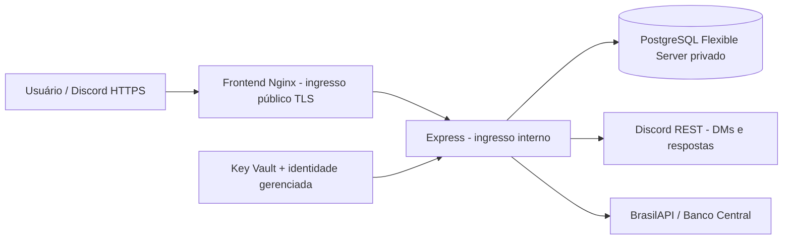

# Azure — preparação, sem provisionamento

Escolha proposta: Azure Container Apps para os contêineres, PostgreSQL Flexible Server gerenciado, Azure DNS e Key Vault. A equipe já tem acesso ao Azure; isso permite concentrar a entrega em um provedor, mantendo a stack. Alternativa: VM Azure com Caddy na frente dos mesmos contêineres e o mesmo PostgreSQL gerenciado. Nenhum recurso foi criado, nenhum deploy foi executado e nenhum custo foi contratado nesta tarefa.

## Roteiro futuro, após aprovação de custos

1. Confirmar assinatura/créditos de estudante e região. Cotar Container Apps com pelo menos uma réplica sempre ativa, PostgreSQL, armazenamento/backups, registro de imagens, rede, DNS, domínio e Log Analytics. Preencher `custos.csv` com a calculadora do Azure na região escolhida; preços não foram presumidos. Definir alertas equivalentes a US$25/50/100 no Cost Management antes de criar recursos. Orçamentos alertam, não interrompem automaticamente o consumo.
2. Planejar resource group, VNet e sub-redes para aplicação e banco; PostgreSQL com integração privada e zona DNS privada ligada à VNet. Não liberar `0.0.0.0/0` nem a opção ampla de todos os serviços Azure. A migração deve rodar de processo com acesso à mesma rede privada.
3. Criar o Flexible Server no momento autorizado, descobrir o FQDN em Connection strings, gerar credencial exclusiva de produção e usar TLS (`sslmode=require` no Prisma; validar cadeia de confiança e política TLS do provedor). Fazer backup e testar restauração. O Compose PostgreSQL permanece apenas local.
4. Criar identidade gerenciada com leitura somente dos segredos necessários no Key Vault. Cadastrar DATABASE_URL, JWT_SECRET (aleatório >=32 caracteres), DISCORD_BOT_TOKEN, DISCORD_ENCRYPTION_KEY e token de métricas. Application ID/Public Key/Guild ID podem ser configuração, nunca publicar o token. Não reutilizar senhas do Compose.
5. Construir imagens a partir desta branch após revisão. Backend usa `backend/Dockerfile`. O exemplo `frontend.Dockerfile` nesta pasta usa o contexto da raiz e proxy HTTPS para o FQDN interno, resolvendo a diferença para o nome Docker local `backend`. Registrar imagens imutáveis por SHA no registro aprovado. Exemplos YAML desta pasta são templates, não recursos já existentes.
6. Executar `prisma migrate deploy` em tarefa única na rede privada, com imagem e secrets aprovados. Registrar migrations/status/health e evidência de que dados antigos permaneceram. Evitar migrações destrutivas; expandir schema antes de publicar código dependente.
7. Publicar API com ingresso interno na porta 3000 e frontend com ingresso público apontando para a porta 8080 do contêiner de exemplo (NGINX sem root). URL pública da aplicação é também a origem da API (`/api`), inclusive `/api/webhook/discord`. `CORS_ORIGINS` precisa ser o domínio exato. Conferir cadeia de proxies antes de fixar TRUST_PROXY_HOPS. `nginx.conf.template` não encaminha `/internal/metrics`.
8. Inicialmente manter backend com minReplicas=1 e maxReplicas=1 e revisão única, para o node-cron não parar por scale-to-zero. Locks e chaves no PostgreSQL protegem concorrência, mas os cron existentes só disparam com processo vivo; recuperação dos jobs já existe. Para alta disponibilidade futura, separar execução de cron/worker ou Azure Container Apps Jobs, compartilhando os mesmos módulos e locks; não ativar dois agendadores independentes sem teste. Ingresso saudável não é prova de execução pontual de jobs.
9. Registrar domínio no registrador escolhido e criar zona Azure DNS; anotar nameservers reais devolvidos e delegá-los no registrador. Usar CNAME direto do subdomínio ao FQDN público do Container App e TXT de verificação solicitado pelo portal. Para domínio raiz, usar A no IP do ambiente e registro de verificação apropriado. Não inventar endereço nem nameserver. Conferir `nslookup` e propagação antes do certificado.
10. Vincular domínio e certificado gerenciado no Container Apps. Certificado gerenciado exige ingresso e domínio acessíveis para validação; CNAME intermediário pode impedir emissão/renovação, e CAA deve permitir o emissor quando configurado. Registrar o emissor e a validade reais. Na alternativa VM, usar Caddy/Let's Encrypt com DNS já apontado e 80/443 abertos, não certificado autoassinado.
11. No **novo SaldoPlusBot**, validar identidade e registrar comandos; configurar URL HTTPS definitiva. Demonstrar PING, slash command, DM, botão, 401 por assinatura inválida e persistência. Não usar túnel como publicação final. Não expor banco ou painéis de monitoramento publicamente.
12. Validar monitoramento privado, alertas de falhas da fila/jobs, logs sem conteúdo financeiro, retenção e custos. Guardar prints sanitizados de rede, DNS, certificado, banco, migrations, webhook, health, CI e orçamento.

## Custos e encerramento

Não há promessa de instância gratuita permanente. O modelo de custo deve incluir horas ativas (até 730/mês), armazenamento e backups do banco, DNS/consultas, registro de imagens, tráfego e retenção de logs. Cotação depende de região, moeda, plano e créditos reais; preencher antes de qualquer ação. Desligar compute pode manter custos de discos, backups, IP, DNS e logs. Conferir a política atual de parada/reinício do Flexible Server; não presumir suspensão ilimitada. Após avaliação, exportar dados necessários e planejar exclusão dos recursos autorizados com o responsável da assinatura. Não executar limpeza de produção automaticamente.

## Referências oficiais e evidências pendentes

[Container Apps](https://learn.microsoft.com/en-us/azure/container-apps/overview), [rede privada do PostgreSQL](https://learn.microsoft.com/en-us/azure/postgresql/network/concepts-networking-private), [Azure DNS e delegação](https://learn.microsoft.com/en-us/azure/dns/dns-delegate-domain-azure-dns), [domínio e certificado gerenciado](https://learn.microsoft.com/en-us/azure/container-apps/custom-domains-managed-certificates), [budgets/alertas](https://learn.microsoft.com/en-us/azure/cost-management-billing/costs/tutorial-acm-create-budgets).

Pendentes: região/plano e cotação aprovados; domínio/NS/IP reais; infraestrutura, banco privado e certificados; alertas configurados; testes na nuvem e captura das evidências B.8/B.9. O material é preparação e não comprova publicação.
